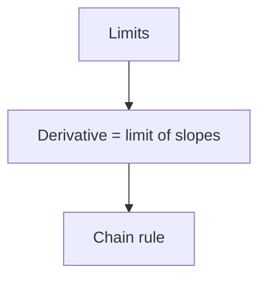

# The vault — where everything lives

The project folder is the Obsidian vault; this repo is its `.claude/` folder. Every durable piece of state is a markdown file in the vault — there is no hidden state, so a lesson resumes from its files alone. Paths below are relative to the project root (where Claude Code runs).

```
lessons/<lesson-slug>/
  log.md          the transcript, written by the md-log hook — never edit it yourself
  assessment.md   what the probe measured; frontmatter `phase` is the lesson's state
  plan.md         the plan map; the hook marks `current` / `visited`
practice/
  <YYYY-MM-DD>-<slug>.md   a practice session's transcript (md-log)
  retest.md                practice misses waiting for a fresh-surface retest
graph/
  <idea-id>.md    one generated note per extracted idea — written only by graph.mjs
  .graph.json     the graph's store (Obsidian ignores dot-files)
viz/              published diagrams (the visual makers)
.claude/.scratch/ your private working files (gitignored, invisible to Obsidian)
```

## Linking a log

Logging starts by linking a file to the session:

```bash
node .claude/scripts/md-log.mjs --link lessons/<lesson-slug>/log.md
```

It takes effect on the next hook and backfills the session so far. Link at the start of every session that works on a lesson — including a resumed one (a new Claude Code session has no link until you make it). `node .claude/scripts/md-log.mjs --unlink` stops logging.

Lesson slugs are lowercase kebab-case from the topic (`chain-rule`, `tcp-congestion-control`). Before creating one, `Glob` `lessons/*/assessment.md` and reuse an existing lesson if it's the same topic.

## assessment.md

```markdown
---
lesson: <lesson-slug>
topic: <the topic in their words>
phase: probe        # probe → plan → teach → done
goal: <the concrete goal, one line>
started: <YYYY-MM-DD>
last_session: <YYYY-MM-DD>
---
# Assessment — <topic>

## Goal
<the concrete goal, as settled with them>

## Strands
### <strand name>
- **Floor:** <what they reliably got right — the evidence>
- **Ceiling:** <where it ran out — the evidence>
- **Misconceptions:** <each wrong model caught, with its extent> | none seen
- **Build from:** <where teaching on this strand should start>

## Summary
<two or three sentences: the shape of their understanding relative to the goal>

## Open doubts
<facts you flagged as uncertain and must revisit> | none
```

`phase` is the lesson's state machine:
- `probe` — the probe is running (the file exists with frontmatter only, or partial notes).
- `plan` — strands are written; the plan isn't approved yet.
- `teach` — the plan is approved; teaching is under way.
- `done` — the goal node was checked and held.

Update `last_session` whenever you work on the lesson. Edit the strands when teaching reveals the probe was wrong about them — the assessment is a living model, not a historical record.

## plan.md

~~~markdown
---
lesson: <lesson-slug>
goal: <goal node slug>
current:
visited: []
---
# Plan — <topic>

<the approach, in prose: what, in what order, and why this way>


~~~

Strict parts (the hook parses them):
- **One node declaration per line**, `slug["Label"]`. Slugs are lowercase `a-z 0-9 - _`, chosen once and **permanent** — questions reference them.
- **One edge per line**, `from --> to`, meaning *from must be understood before to*.
- Everything from the `%% status` line down is managed by the hook — when you rewrite the plan, drop that block (the hook regenerates it on the next tagged question) and keep the frontmatter's `current` / `visited` as they are.

## The graph

The graph is what they have been taught across every lesson and imported note: true ideas and the chains of reasoning that derive them. It is written **only** by `/extract` and `/import-notes` (through `graph.mjs`). To read it:

```bash
node .claude/scripts/graph.mjs sources                 # every source and its idea count
node .claude/scripts/graph.mjs list --source <path>    # one source's ideas, ids verbatim
node .claude/scripts/graph.mjs list                    # everything
```

…or `Grep` / `Read` the notes in `graph/` directly. A graph idea is evidence they were *taught* it, not that they still hold it — it tells the probe where to look, never what to skip without checking.

## practice/retest.md

```markdown
# Retest queue

- [ ] <the target idea, one line> — [[<graph-id>]] — <miss class> — from [[practice/<session>]]
- [x] <…> — retested <YYYY-MM-DD>, solved at R0
```

Unchecked items are waiting. A retest is always a fresh surface — never the original problem.
